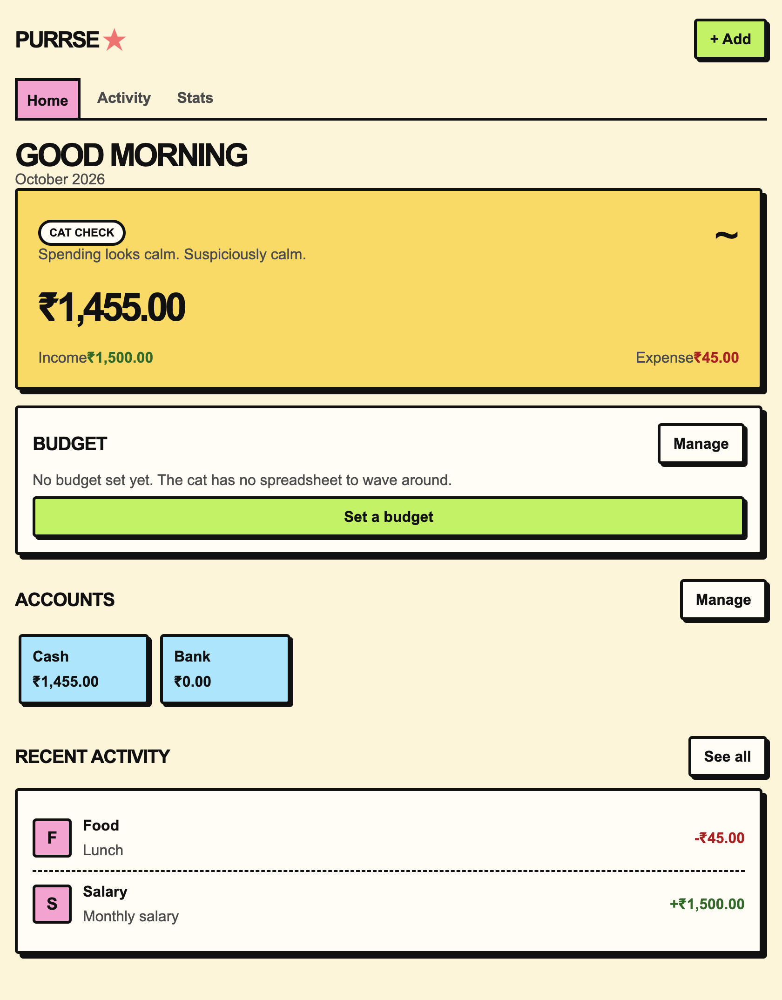
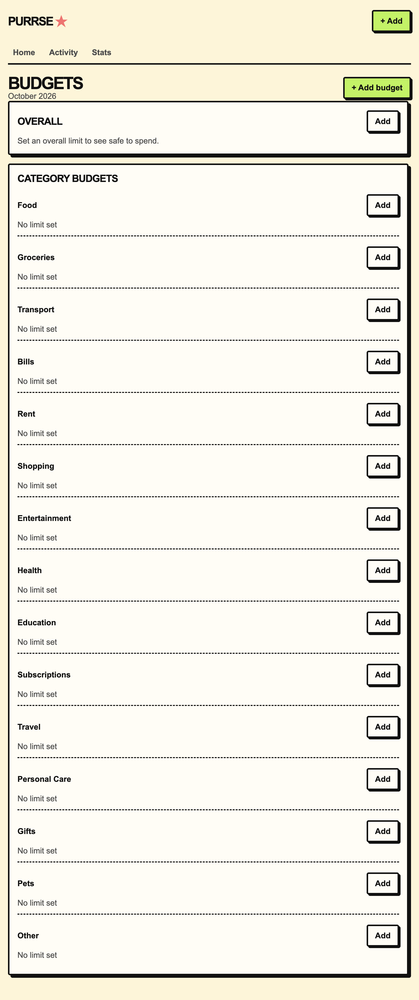
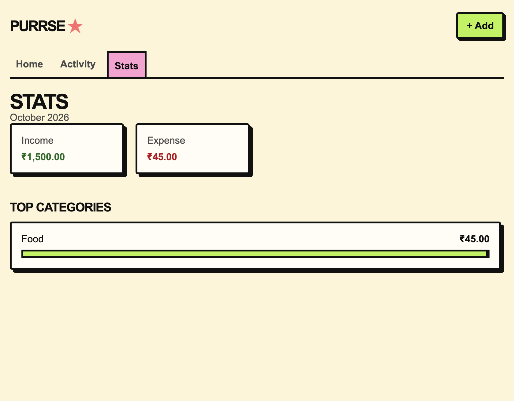
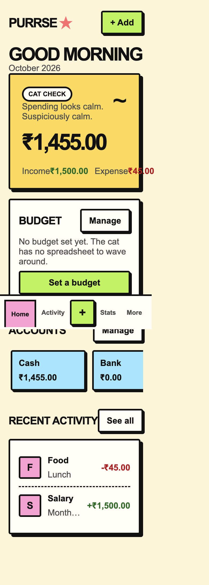

# Purrse

> **Money tracking with a cat that has opinions.**

Purrse is a privacy-first personal finance tracker with a light neo-brutalist interface. Log expenses, income, and transfers, watch budgets, and keep the whole money story in your browser.

<p align="center">
  <a href="https://thelinuxguy-ssh.github.io/puurse/"><strong>Live demo</strong></a>
  ·
  <a href="https://github.com/TheLinuxGuy-ssh/puurse/issues">Report an issue</a>
  ·
  <a href="https://github.com/TheLinuxGuy-ssh/puurse">View source</a>
</p>

## Demo first

> A short product walkthrough is the first thing this section is designed to host. Add the exported walkthrough as `assets/demo.mp4` and it will appear directly above the screenshots.

<video controls width="100%" poster="./assets/dashboard.png">
  <source src="./assets/demo.mp4" type="video/mp4">
  Your browser does not support embedded video. See the screenshots below.
</video>

## Preview

| Dashboard | Budgets |
| --- | --- |
|  |  |

| Stats | Mobile |
| --- | --- |
|  |  |

## Why Purrse?

Personal finance tools often feel like spreadsheets wearing a suit. Purrse keeps the useful parts and gives them a friendlier surface:

- **Private by default:** no account, backend, analytics, or tracking
- **Fast to use:** log an amount, choose a category, and move on
- **Light visual language:** thick borders, offset shadows, paper tones, and playful accents
- **Honest data model:** amounts are stored as integer minor units and dates stay local
- **Static and portable:** deployable to GitHub Pages with no build step

## Features

### Money in and out

- Expense, income, and transfer transactions
- Safe calculator expressions such as `250+80*2`
- Expense and income categories
- Account balances with transfer-aware calculations
- Future-dated transactions excluded from current balances
- Searchable activity list
- Edit and delete transactions

### Budgets

- Overall monthly budget
- Category budgets
- Usage percentages and progress bars
- Over-budget warnings
- Safe-to-spend-today calculation

### Backups

- JSON export
- JSON import with merge or replace
- Import size and structure validation
- Sample data for trying the app quickly

### Experience

- Responsive mobile and desktop layout
- Mobile bottom navigation with no duplicate tablet navigation
- Neo-brutalist visual system
- Keyboard-friendly controls and visible focus states
- Reduced-motion support
- Strict Content Security Policy

## Run locally

Purrse uses native ES modules, so it needs a local HTTP server.

```bash
git clone https://github.com/TheLinuxGuy-ssh/puurse.git
cd puurse
python3 -m http.server
```

Open [http://localhost:8000](http://localhost:8000).

## Project structure

```text
.
├── index.html
├── tests.html
├── manifest.webmanifest
├── assets/
│   ├── icon.svg
│   ├── dashboard.png
│   ├── budgets.png
│   ├── stats.png
│   └── mobile.png
├── css/
│   └── styles.css
└── js/
    ├── main.js
    ├── budgets.js
    ├── dates.js
    ├── models.js
    ├── money.js
    └── store.js
```

## Privacy

Purrse stores data locally in `localStorage` under the key `purrse_v1`. Data does not leave the browser unless you explicitly export it.

The backup export is a JSON file containing your application data. Keep exported backups somewhere safe. The convenience lock planned for a later phase would not be encryption, and the current app makes no claim that local browser storage is encrypted.

## Money and dates

Amounts are stored as integer hundredths. For example, `₹123.45` is stored as `12345`. This avoids floating-point surprises and means changing currency formatting never changes the underlying amount.

Dates are stored as local `YYYY-MM-DD` strings. Purrse does not parse those strings through the UTC-sensitive `new Date("YYYY-MM-DD")` shortcut.

## Tests

Open [tests.html](./tests.html) from the local server. It runs without a test dependency and covers:

- Money parsing and formatting
- Calculator expression safety
- Custom budget periods
- Budget thresholds
- Expense-only budget totals
- Safe-to-spend calculations

## How I used GitHub Copilot

Copilot helped turn the product brief into a small static application, explore edge cases in money and date handling, review the responsive interaction model, and iterate on the neo-brutalist interface. The implementation was reviewed and adjusted in the repository rather than accepted blindly.

## Inspired by

Purrse is inspired by the idea of cat-themed expense tracking. All Purrse names, copy, artwork, and implementation are original.

## License

MIT. See [LICENSE](./LICENSE).
